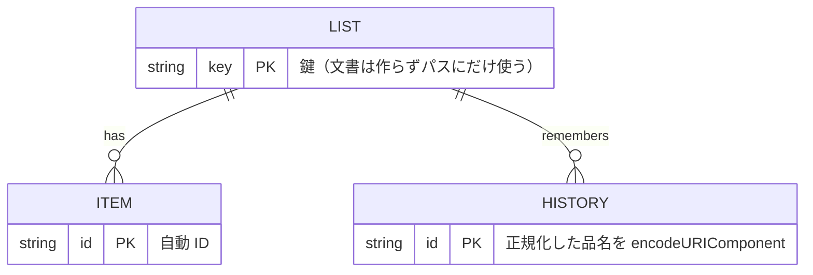

# 設計メモ

2人（同居のカップル）で同じ買い物リストを見て、足して、チェックする PWA。

## 結論

- 画面は GitHub Pages（Vite + React + TypeScript）。共有の保存先は Firebase Firestore（Spark 無料枠、プロジェクト `kaimono-776d83`）。
- ログインは無い。リストは `lists/{鍵}/…` に置き、鍵（128bit 乱数の16進32桁）を知っている人だけが読み書きできる。`firestore.rules` は鍵の SHA-256 だけを持ち、リポに鍵は載らない。
- 鍵はリンク `https://iiiitiiitiiti.github.io/kaimono/#k=<鍵>` で渡す。鍵の本体はこの PC の `.secret-key`（git 管理外）にだけある。

## なぜこの形か

| 案 | 採らなかった理由 |
|---|---|
| Artifact の db | 相手にも Claude のアカウントと招待が要る。毎回 claude.ai を通る |
| Firebase Auth の世帯共有アカウント（動物園ログと同じ） | サインイン方法の有効化と利用者作成に Firebase Console の手作業が要る。合言葉を2人が覚えて打つ必要がある。守るものが品目リストなので重さが見合わない |
| 鍵をパスに入れる（採用） | 作成者の手作業ゼロ、相手はリンクを開くだけ。漏れたら鍵を作り直して rules を再デプロイする |

レビュー（fable-advisor、2026-11-04）で A を支持。指摘を反映した点:

- iPhone は Safari・LINE 内ブラウザ・ホーム画面のアプリで保存場所が別。鍵を URL から消すとホーム画面のアプリで鍵が無くなるので、鍵は URL のハッシュに残す。
- そのためマニフェストを置かない（`start_url` で起動すると鍵が落ちる）。ホーム画面用の見た目は `index.html` の `apple-*` と `apple-touch-icon.png` で指定する。
- rules は `hashing.sha256(key).toHexString().lower() == "<hex>"` で照合する。`lists` の一覧取得と collectionGroup は match が無いので拒否される。

## データ

- ITEM: 品名・売り場・数量メモ・足した人・チェック済みか・足した時刻・チェックした時刻。
- HISTORY: 品名ごとの回数・最後に足した時刻・売り場。よく買う物の候補と売り場の推測に使う。品名の同一判定は全角半角・大小・空白・カタカナひらがなを無視（`nameKey`）。
- 足した人の名前は端末ごとに覚える（localStorage）。

## 決めたこと

- お店の種類は10種の固定（`src/model.ts` の `SECTIONS`）。品名から手がかり語で推測し、一度直したお店は履歴で覚える。コードと保存先の項目名は `section` のまま。
  - 最初はスーパーの売り場（野菜・肉など）で分けていた。スーパー以外でも買うので、スーパー・ドラッグストア・家電量販店くらいの粒度に変えた（2026-11-04 ユーザー指摘）。変えた時点の品物はすべて「その他」で、移し替えは要らなかった。
- チェックした物は「かごに入れた」に移り、「まとめて消す」で消す。消す操作には6秒間の取り消しが付く。
  - 「かごに入れた」はふだん畳んでおき、押すと開く（2026-11-05 ユーザー依頼）。
- お店で絞れる（2026-11-05 ユーザー依頼）。使いたいときだけ使うので、リストの上に畳んだ「お店で絞る」を置く。品物があるお店が2つ以上のときだけ出す。
  - 選んだお店は覚えない。家で開いたときに品物が隠れていると、足し忘れや二重に足す元になる。
  - 畳んでも選んだお店の名前は見出しに残す。絞ったまま忘れないようにするため。
  - かごに入れた物も同じお店で絞る。
- 畳める欄は開け閉めで高さが伸び縮みする（2026-11-05 ユーザー依頼、`src/disclosure.ts`）。iPhone の Safari は CSS だけでは高さを auto まで動かせないので、見出しを押したときに開閉を引き取って動かす。動きを減らす設定の人にはふつうの開け閉めのままにする。メニューの中の畳める欄にも同じ動きが付く。
  - 絞っているお店と違う物を足したときや、二重に足そうとした物が隠れていたときは全部に戻す。足した物が見えないと、足せていないと思って二重に足すため。
- まだ買っていない同じ物は二重に足さず、既にある行を光らせる。
- 行を左になぞると「直す」「消す」が出る（2026-11-04 ユーザー依頼）。品名を押して直す画面を開く道も残す（読み上げやキーボードの人はこちらを使う）。開くのは1行だけで、ほかに触れると閉じる。縦のスクロールは `touch-action: pan-y` でブラウザに任せる。
- 店で電波が弱くても使えるよう、Firestore の端末内キャッシュ（persistentLocalCache）を使う。書き込みは待たずに画面へ出す。
- 保存先の場所は nam5（米国）。`firebase deploy` が自動作成したため。端末内で先に反映されるので体感の遅れは出ない。東京へ移すならデータベースを作り直す。
- 画面は「見えている範囲」いっぱいの箱にし、リストの欄だけをスクロールさせる。iPhone はキーボードが出ても画面の高さを変えずページをずらすので、visualViewport の高さと位置を `src/viewport.ts` が CSS 変数へ入れる（2026-11-04 ユーザー指摘で変更）。
- ただし補正はキーボードが出きってからしか効かず、iPhone がページをずらす間ヘッダーが一度消えて戻った。指で足す欄を押したときは、画面の上端の見えない欄で先にキーボードを出し、画面が縮んでから本物へ移す（`src/keyboardFirst.ts`）。上の欄も縮んだあとの本物も隠れないので、iPhone はずらさない。移し替えでキーボードが閉じた端末では次から使わない（端末に覚える）。
  - 数量・メモ欄を押したときもヘッダーが消えた（同日ユーザー指摘）。仕掛けを足す欄の入力欄すべてに広げた。キーボードが出ている間に別の欄を押したときは、ずらさない指定でそのまま移す。
  - 売り場を iPhone の選択メニューで選ぶとキーボードが閉じた（同日ユーザー指摘）。足す欄の売り場は画面の中のボタンから選ぶ形にし、押しても入力欄のフォーカスを外さない。直す画面の売り場は選択メニューのまま。
  - 一覧を足す欄の中に出すと、入力中のカーソルが上へずれて見えた（同日ユーザー指摘）。足す欄が伸びて入力欄の入れ物が変わると、iPhone はカーソルを古い位置に描くと見ている（仕組みは実機で観測していない）。一覧は足す欄のすぐ上に重ねて出し、足す欄の大きさを変えない。これで直ったとユーザーが実機で確認した。
  - 「足す」を2回押さないと足せなかった（同日ユーザー指摘）。押した瞬間に入力欄から離れると、入力欄を外したら画面いっぱいに戻す直しが効いて足す欄が下へ動き、指を離す前にボタンが逃げていた。足す欄のボタンは押しても入力欄から離れないようにする（見えない Chrome で確かめた。直す前の版では足せず、直した版では1回で足せた）。
- キーボードを開いたまま短いリスト（2品以下）をなぞると画面が震えた（2026-11-04 ユーザー指摘）。リストの欄がスクロールできないと、指の動きが iPhone のページずらしに渡り、`src/viewport.ts` の補正と取り合うため。リストの中身を欄より常に 1px 高くして欄の中でスクロールさせ、ヘッダーと足す欄の上で指を動かしたときはページを動かさない（よく買う物の横スクロールと入力欄の中は除く）。
  - 1px 高くするのはキーボードが出ている間だけ。キーボードが無いときは、収まっているリストをなぞっても動かさない（同日ユーザー指摘）。
- 入力欄を外したあと、足す欄の下が空いた（2026-11-04 ユーザー指摘）。iPhone はキーボードが閉じても「見えている範囲」を縮んだまま報告することがあると見ている（実機の値は未確認）。見えている範囲に合わせるのは、入力欄を使っていてキーボードが出ている間だけにし、それ以外は画面いっぱいにする。
- Codex のレビュー（2026-11-04）を受けて直したこと:
  - 見えない欄を読み上げから隠す
  - 品物とよく買う物の回数を1回の書き込みにまとめる
  - 保存失敗の案内を「取り消す」の案内と別に出す
  - rules で売り場名を10種に限る（`tests/rules.test.ts` が `SECTIONS` との一致を確かめる）
- 同じレビューで直さないと決めたこと: 同時に足すと2行になる件・500品を超える一括削除・新しい版の入れ替えの遅れ。2人のリストでは困らない。
- 文字ファイル（Noto Sans JP、全部で約6MB）は最初に取り込まず、使った分だけキャッシュする。

## やらないこと

- 複数リスト（店ごとの切り替え）、ログイン、通知、価格の記録。

## 鍵を作り直すとき

1. 新しい鍵を作る: `node -e "console.log(require('crypto').randomBytes(16).toString('hex'))"`
2. その SHA-256 を `firestore.rules` の照合値に書き、`firebase deploy --only firestore:rules`
3. 古い鍵のデータは読めなくなる（必要なら移してから差し替える）
4. 新しいリンクを2人に送り直す
